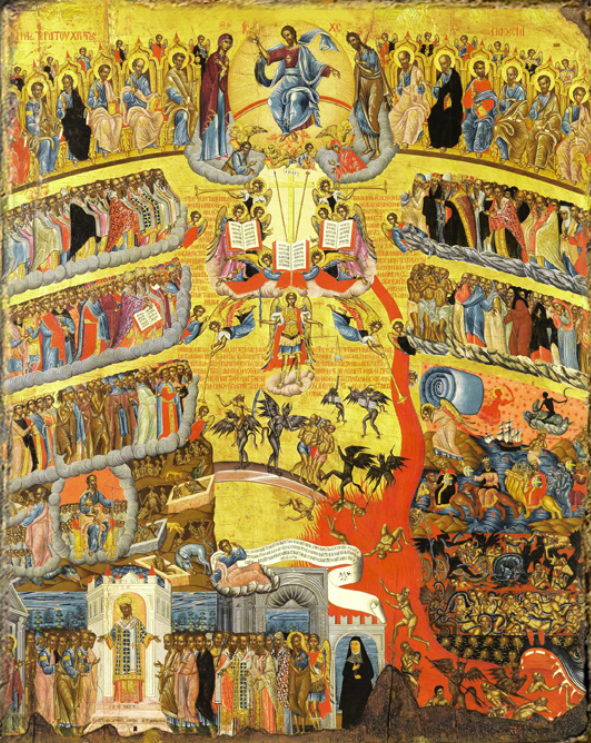

# ΔΕΥΤΕΡΑ ΠΑΡΟΥΣΙΑ (ΗΜΕΡΑ ΤΗΣ ΜΕΛΛΟΥΣΗΣ ΚΡΙΣΕΩΣ/ΣΥΝΤΕΛΕΙΑ ΤΟΥ ΚΟΣΜΟΥ)

Αποσπάσματα από την Καινή Διαθήκη σχετικά με τη Δευτέρα Παρούσια και την έλευση του Ιησού Χριστού.
Περιγράφονται τα γεγονότα σχετικά με την ημέρα της τελικής κρίσης και τη συντέλεια του κόσμου.

Τα χωρία τα οποία αναφέρονται είναι από:
- Κατά Ματθαίον Ευαγγέλιο
- Κατά Λουκάν Ευαγγέλιο
- Επιστολή Πέτρου Β'
- Κατά Μάρκον Ευαγγέλιο

